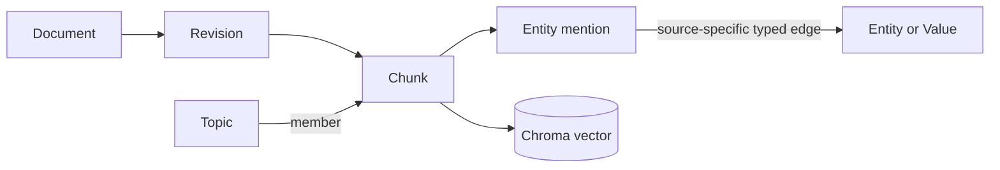

# Person 1 — Contracts, graph/vector storage, and lifecycle

## Scope

This is the shared foundation for the revised Phase 1 and Phase 2 prototype. It supersedes earlier small-MVP task files. The product must ingest PDF/TXT, build a graph plus vector store, answer grounded questions, show paths in the UI, then support updates, conflicts, injection tests, Hindi questions, and a 500-document benchmark.

Own `backend/contracts`, `backend/storage`, IDs, migrations, revision publishing, deletion, and integration fixtures. Do not implement parsing, extraction prompts, topic clustering, routing, UI, or answer generation.

## Chosen storage design

- Neo4j AuraDB stores documents, revisions, chunks, entities, source-specific relationships, topics, memberships, conflicts, operations, and provenance.
- Persistent Chroma stores one explicit multilingual embedding per active chunk.
- FastAPI is the application service. All graph/vector access goes through repositories; no direct database access from UI or extraction code.
- AuraDB is hosted, not embedded. This satisfies the requested graph database role while preserving the problem statement’s graph-plus-vector design.



## Contract: publish before other work starts

Use Pydantic v2 with `extra='forbid'`, UTC timestamps, JSON-safe dictionaries, finite numbers, and explicit defaults. Generate JSON Schema and TypeScript types from the Python models. No copied schemas.

| Model | Required fields |
|---|---|
| Document | `id, workspace_id, filename, source_type(pdf|txt), active_revision_id?, deleted, created_at` |
| Revision | `id, document_id, content_hash, parser_version, chunker_version, extractor_version, embedding_version, state(staged|published|retired|failed), source_ref, created_at` |
| Chunk | `id, workspace_id, document_id, revision_id, index, text, text_hash, location(page?, element_ids, start_offset, end_offset)` |
| Entity | `id, workspace_id, name, normalized_name, type, aliases` |
| Value | `id, workspace_id, kind(text|number|date), lexical_value, normalized_value, unit?` |
| Evidence | `chunk_id, start, end, quote` |
| Relation | `id, workspace_id, revision_id, subject_id, object_entity_id? XOR object_value_id?, predicate, predicate_original, polarity(positive|negative), modality(asserted|possible|planned|conditional), condition?, valid_from?, valid_to?, evidence, extraction_method, extraction_model, extraction_version` |
| Topic | `id, workspace_id, label, description, cluster_version, embedding_version, centroid, representative_chunk_ids, summary_evidence_ids, summary_status, active` |
| TopicMembership | `topic_id, chunk_id, revision_id, method(cluster|centroid), score, assignment_version` |
| Conflict | `id, workspace_id, left_relation_id, right_relation_id, kind(negation|exclusive_value|incompatible_statement), state(potential|supported), explanation, evidence_chunk_ids, detector_version` |
| Operation | `id, workspace_id, document_id, kind(add|edit|delete), expected_revision_id?, new_revision_id?, state(queued|running|ready|failed), stage, accepted_at, visible_at?, finished_at?, deadline_at, checkpoint, counts, timings_ms, warnings, errors` |
| QueryRequest | `workspace_id, question, topic_ids, scope(workspace|selected), answer_language(auto|en|hi), top_k(1..30), max_hops(1..4)` |
| QueryResponse | `request_id, corpus_epoch, status(answered|insufficient_evidence|retry_required), language(en|hi), plan, statements, evidence, graph, latency_ms, warnings` |

`Evidence.quote` must exactly equal `Chunk.text[start:end]`; offsets are Unicode code points and end-exclusive. A conditional relation requires `condition`. Relation endpoints and evidence must share workspace and revision. Any source-specific relation is initially unverified by design; extraction confidence is not truth probability.

## IDs and graph writes

Use full SHA-256 over canonical JSON. Logical Document ID is server UUID and survives edits. Revision ID hashes document ID, content hash, and pipeline configuration. Chunk ID hashes revision ID, index, text hash, and location. Entity ID uses workspace + type + normalized name. Relation ID includes revision, both endpoints/value, predicate, qualifiers, and exact evidence. Topic IDs are UUIDs, never embeddings.

Direct typed relationships carry every relation/provenance field and are merged by `relation_id`, never merely by endpoints/type. This preserves parallel edges from different sources and contradiction pairs. Use fixed relationship types from a server allowlist; model text never becomes Cypher syntax.

Neo4j constraints cover IDs. Add full-text indexes for chunks/entity names. Chroma records use Chunk ID with explicit vectors and metadata for workspace/document/revision/model version. Do not mix embedding dimensions or model revisions in one collection.

## Revision publication and deletion

Neo4j and Chroma are not one transaction. Use staged revisions and an authoritative active-revision pointer:

1. Create an Operation and a staged Revision.
2. Stage graph records and Chroma vectors; active queries exclude them.
3. Person 3 prepares topics/conflicts using the staged revision and current snapshot.
4. Verify source evidence, vector count, and references.
5. Under a short publication lock, switch Document.active_revision_id, apply topic/conflict changes, retire old revision relations, increment corpus epoch, and publish the operation.
6. Remove old vectors/derived records. New queries filter to active revision IDs even during cleanup.

Delete clears the active revision pointer and topic/conflict state under the same lock, then removes dependent chunks, source edges, vectors, and memberships. Shared entities and relations supported by other active revisions remain. If a query sees an epoch change, it retries once; it never returns a mixture of old and new evidence.

Phase 2 timing runs from mutation acceptance until cleanup and a read probe confirm the new state is visible. Do not report success after staging alone.

## Interfaces

```python
stage_batch(operation_id, extraction_batch) -> None
get_snapshot(workspace_id) -> CorpusSnapshot
publish(operation_id, derived_delta, expected_epoch) -> PublishReceipt
cleanup(operation_id) -> None
vector_candidates(vector, snapshot, limit) -> list[str]
lexical_candidates(text, snapshot, limit) -> list[str]
fetch_evidence(chunk_ids, snapshot) -> EvidencePackage
expand_paths(entity_ids, snapshot, max_hops) -> list[EvidencePath]
```

All repository reads apply workspace plus active-revision filters. Bounded graph responses contain at most 200 nodes and 300 edges and carry a truncation flag.

## Tests and handoff

Deliver first: contracts, deterministic ID vectors, a valid one-document fixture, and a storage fake. Then demonstrate a real document/chunk/vector/edge round trip.

- Re-ingestion is idempotent.
- Two opposed source statements remain two edges and two evidence links.
- A Chroma-stage or graph-publish failure leaves old active content visible.
- Deleting one source does not delete another source’s evidence.
- A query during update cannot mix revisions.
- Unknown relationship types and cross-workspace references are rejected.

Person 2 gives you canonical extraction batches; Person 3 gives topic/conflict deltas; Person 4 uses only your published repositories. Do not let integration proceed to UI polish until this lifecycle test passes.
