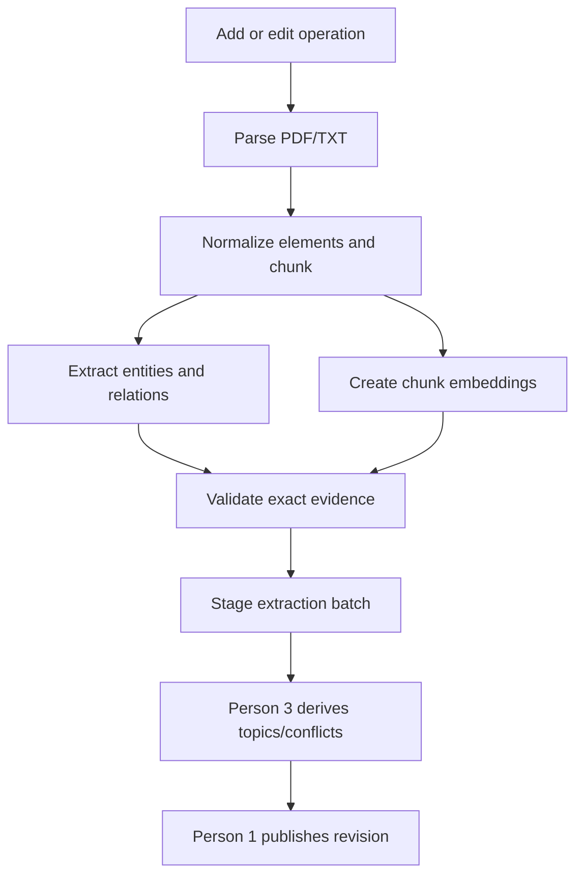

# Person 2 — Ingestion, extraction, embeddings, and scale measurement

## Scope

Own `backend/ingestion`, parser/extractor/provider adapters, embedding adapter, durable operation runner, ingestion fixtures, and throughput metrics. Use contracts and storage methods from file 01. Do not write directly to Neo4j/Chroma, define alternate models, create topics, route questions, or build UI.

## Required pipeline



## Phase 1 spike: prove the reused stack

Before building bulk ingestion, run one selectable-text PDF and one TXT through:

- Unstructured API, capturing element/page order and provider job identifiers.
- A pinned `neo4j-graphrag` entity/relation extraction component, intercepted through a custom writer/adapter rather than writing to the active graph.
- The chosen multilingual embedding provider.

Prove that every extracted relation can be linked to an exact quote in a known chunk. If the builder’s default result lacks quote-level provenance, customize its extraction template/result adapter. This is a blocking issue, because the product requires supporting paths and source evidence. Test one negative and one conditional sentence. Freeze package/model/prompt/tokenizer versions and dimensions in `config/pipeline-lock.json`.

## Parsing and chunks

Release inputs: PDF with extractable text and strict UTF-8 TXT. No OCR, URLs, repository uploads, code/config parsers, or execution of document content.

- Original bytes get SHA-256 content hash. Source paths and external instructions remain untrusted data.
- For PDF, use Unstructured’s job/workflow API; provider waiting time counts in real timing.
- TXT normalizes CRLF/CR to LF and removes NUL only. Decode errors fail.
- Preserve page and element IDs. Offsets refer to normalized text, not PDF bytes; PDF pages are one-based.
- Empty/scanned PDF returns `NO_EXTRACTABLE_TEXT`, never a successful document.
- Use one deterministic, element-aware chunker: target 600 tokens, max 800, max 60 overlap, no cross-page merge. Pin tokenizer/version. Oversize element splits produce a warning.
- Candidate relations have one primary source span. Cross-chunk ambiguity must remain unresolved; do not invent a relationship.

## Extraction policy

Use KG-builder extraction for general prose. Freeze a small controlled schema after the pilot: Person, Organization, Place, Concept, Event, System, Artifact, Entity fallback; predicates PART_OF, USES, DEPENDS_ON, LOCATED_IN, CREATED_BY, ASSOCIATED_WITH, HAS_VALUE, RELATED_TO fallback. Preserve original wording and issue warnings on fallback. This is a reproducibility schema, not a universal ontology.

Use exact name/type matching only. No fuzzy or semantic entity merging. Values such as dates, quantities, and statuses become Value nodes through Person 1’s canonical batch, so newer source values never overwrite prior source evidence.

The prompt must delimit document text as data, demand atomic source-supported statements, quote, polarity, modality, condition, and temporal qualifier. No model tools, network access, raw Cypher, or permission instructions. Validate response structure, exact quote, references, qualifier preservation, and direction before staging. Invalid individual candidates become warnings; malformed full output fails that chunk. Valid empty extraction is recorded separately from failure.

Allow two transient retries and one formatting repair within the operation deadline; record every wait/retry. Never retry indefinitely. Cache extraction by text/context hash plus parser/chunker/extractor/schema/model/prompt versions. A changed document revision rebinds only after exact text/evidence validation.

## Embeddings

Use exactly one pinned multilingual embedding model for documents and Hindi/English queries. Batch embeddings; explicit vector values go to Person 1. Record model revision, dimension, and any query/document prefixes. Reject wrong-length, NaN, or zero vectors. An edit’s old revision remains active if its new vectors are incomplete.

## Operations and Phase 2 deadline

Run a backend-owned bounded executor over durable Operations. On restart, resume from checkpointed private source/parsed/batch artifacts. One operation owns one document; publication stays Person 1’s lock.

An edit only processes its document and sends old/new affected records to Person 3. Delete runs no extraction/embedding calls. The target is 60 seconds from acceptance to visible, cleaned update. Measure every stage; do not stop the clock at HTTP acceptance, staging, or model completion.

Initial allocation for diagnosis: queue 2s, parsing 12s, chunk/cache 2s, extraction+embeddings 25s, topic/conflict delta 8s, publish/cleanup/probe 8s, reserve 3s. These are not guarantees. If external provider delay prevents the requirement, report the failure rather than hiding it through a corpus rebuild or a changed parser.

## Interfaces

```python
parse_source(source_ref, source_type) -> ParsedSource
chunk_source(parsed, document, revision) -> list[Chunk]
extract_chunk(chunk) -> CandidateGraph
embed_texts(texts, purpose: Literal['document','query']) -> list[list[float]]
build_batch(operation) -> ExtractionBatch
run_operation(operation_id) -> None
```

## Benchmark and tests

Instrument accepted time, ready time, bytes/pages/chunks, LLM calls/tokens, retries, cache hits, per-stage time, graph/vector counts, and failure reason. Run 500 distinct successful PDF/TXT documents; report corpus composition, page/size percentiles, service region/tier, host resources, revisions, concurrency, and cold versus warm results. Failed documents are reported separately and do not count toward 500.

Tests cover page/offset mapping, Unicode handling, stable chunks, exact evidence, negation/conditional/value statements, model failures, cache invalidation, injection fixtures, no-op re-ingestion, single-document edit, restart recovery, and provider failure retaining old active revision.

Done means P1 receives reproducible, source-supported batches and P4 can show stage timings. Phase 2 is done only after the measured 500-document and update results are available.
