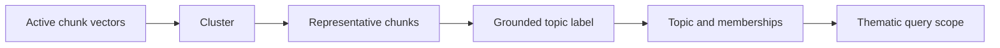

# Person 3 — Topics, routing, retrieval, answers, conflicts, and Hindi

## Scope

Own `backend/topics`, `backend/retrieval`, `backend/answers`, conflict detection, Hindi-query handling, and their tests. Use Person 1’s repositories/contracts and Person 2’s embedding/extraction adapter. Do not parse files, write direct database code, alter lifecycle state, or build the UI.

## Phase 1 topic work

Cluster active chunk vectors inside a workspace. Evaluate HDBSCAN and K-means on the same frozen pilot corpus. Compare topic coherence, duplicate/overlap rate, coverage, stability on rerun, broad-question usefulness, runtime, and labeling cost. Freeze one method/configuration and embedding version before Phase 1 baseline.

For every cluster, choose representative chunks (central plus diverse). Ask the answer model to produce a short label/description only from these chunks. Store representative evidence IDs. Labels are navigation aids, not factual evidence. Unclustered chunks stay searchable. A chunk may have multiple topic memberships.



Phase 2 updates use centroid assignment to existing topics plus a targeted refresh of affected topic descriptions. Never run a full corpus recluster during an add/edit/delete request. Mark `summary_status=needs_refresh` if representative evidence changed; refresh before the operation becomes ready. Periodic global reclustering is outside the 60-second path.

## Query routing and retrieval

Build `plan_query(QueryRequest, CorpusSnapshot) -> QueryPlan` using deterministic rules first:

- Thematic: “main themes,” “patterns,” “across documents,” or topic-list questions.
- Local: named entity, direct fact, or narrow source question.
- Hybrid: multi-hop/connection words or both thematic and named-entity signals.

The router chooses retrieval, not truth. Include a rationale code in output. Evaluate routing correctness on the Phase 1 question set; change rules only through versioned tests.

For local/hybrid: generate the multilingual query vector through P2, retrieve Chroma candidates, run Neo4j full-text search, fuse ranks with reciprocal-rank fusion, then fetch active source edges/chunks. Graph expansion is bounded to four logical entity hops, 200 nodes, 300 edges, and five answer paths. Topic scope filtering applies to both vector candidates and every graph edge; selected scope never silently widens.

For thematic: use active Topic records, representative chunks, per-topic source edges, and exact counts. Do not stuff all documents into a prompt. If a requested workspace has more evidence than the bounded summary package, return `truncated=true`, searched/available counts, and a limitation. A broad answer cannot claim exhaustive themes from top-k alone.

Every EvidencePackage is created from one CorpusSnapshot. If P1 detects an epoch change while the answer is being built, repeat once; otherwise return `retry_required`.

## Grounded answers and paths

The answer model receives only the question, requested language, EvidencePackage, path IDs, source chunk IDs, and strict instructions: no outside facts, every factual statement gets evidence and a path, inferences are labeled, contradictions are shown, absent evidence is said plainly. Return structured AnswerStatements. Server validates every citation/path before responding; invalid output gets one repair, then an extractive insufficient-evidence response.

An EvidencePath contains direct domain edges plus explicit provenance Chunk→Revision→Document links. UI graph edges must expose relation IDs and source chunk IDs. Topic-membership edges are visually distinct and never count as factual support.

## Contradiction requirement

Phase 1 preserves source-specific parallel direct relationships. In Phase 2, detect only defined testable conflicts:

1. Same normalized subject/predicate/object with opposite polarity.
2. Same subject/predicate but distinct normalized Value objects where predicate configuration is exclusive.
3. Explicit incompatible statement pairs in the planted fixture catalog.

Output Conflict records with both relation IDs and both source chunks. Answers/UI show both statements and sources; never choose a winner. Do not claim that lack of a detected Conflict means sources agree.

Before adding a Claim/Assertion node, prove direct source-specific relationships plus Value nodes cannot represent one of the required planted cases without losing information. If it fails, propose the smallest versioned assertion contract to Person 1; do not build it unilaterally.

## Hindi questions over English documents

Keep English source chunks and graph paths unchanged. First use the same pinned multilingual embedding model for Hindi query retrieval. The query planner labels `query_language=hi`; answer model returns Hindi only when requested/auto-detected Hindi, while citations/quotes remain English. Compare this route with a controlled Hindi→English translation baseline on the frozen Hindi question set. Choose the approach with higher grounded-answer/path score; do not translate source evidence away.

## Interfaces

```python
prepare_delta(operation_id, staged_revision_id, snapshot) -> DerivedDelta
plan_query(request, snapshot) -> QueryPlan
retrieve(plan, request, snapshot) -> EvidencePackage
find_conflicts(active_relations, changed_relation_ids) -> list[Conflict]
synthesize(request, package) -> list[AnswerStatement]
```

## Tests and handoff

- HDBSCAN/K-means comparison recorded before Phase 1 baseline.
- Topic memberships stay workspace-local; multi-topic and unclustered chunks work.
- Topic labels cite representative chunks.
- Vector + keyword retrieval returns evidence; underfilled active-filtered ANN returns explicit limitation.
- Paths preserve edge direction and qualifiers; co-occurrence/topic links do not become facts.
- Conflicting planted statements display both sources.
- Hindi questions retrieve English evidence and paths.
- No evidence gives insufficient_evidence, never a made-up connection.
- Update delta touches only affected topics/conflicts and completes under the lifecycle timing test.

Hand P4 QueryResponse fixtures for local, thematic, hybrid, Hindi, conflict, truncation, and insufficient-evidence cases. Hand P1 only DerivedDelta; P1 controls publication.
