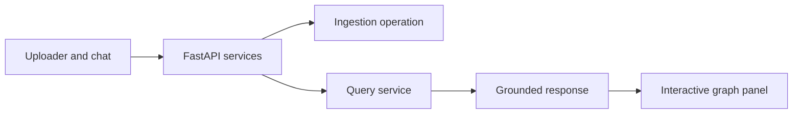

# Person 4 — API, split-screen UI, integration, and acceptance evaluation

## Scope

Own FastAPI adapters/services, React split-screen application, graph rendering, operation/status endpoints, benchmark runner, evaluation data/scoring, and end-to-end tests. Reuse the contracts/services from Persons 1–3; no alternate schemas, prompts, storage clients, or extraction logic.

## Phase 1 product surface

React layout:

- Left: workspace uploader, operation progress/errors, chat box, scope/topic picker, answer with source links and limitations.
- Right: react-force-graph-2d, zoom/pan/click; show entities, values, topics, documents, chunks, and edges. Highlight the selected topic, answer paths, source documents, and conflict pairs.
- Clicking a node/edge opens source name, page/offset, exact quote, predicate/original wording, polarity, modality, source revision, and conflict status.
- Topic-membership and provenance edges have distinct colors/styles from factual relationships. Do not visually imply causal truth.

## API endpoints

| Method | Route | Result |
|---|---|---|
| POST | `/v1/workspaces/{ws}/documents` | add upload → MutationReceipt, 202 |
| PUT | `/v1/workspaces/{ws}/documents/{id}` | edit with `expected_revision_id` → MutationReceipt, 202 |
| DELETE | `/v1/workspaces/{ws}/documents/{id}` | delete → MutationReceipt, 202 |
| GET | `/v1/operations/{id}` | OperationView |
| POST | `/v1/query` | QueryRequest → QueryResponse |
| GET | `/v1/topics?workspace_id=` | TopicList |
| GET | `/v1/chunks/{id}/source` | SourceView |
| GET | `/health` | component readiness and pinned versions, no secrets |

Validate workspace IDs and endpoint/body match. Return typed ErrorResponse. 202 means accepted, never ready. Unknown/unauthorized items are not disclosed. Keep credentials server-side. Do not expose Cypher, raw provider calls, local paths, or uploaded content as executable HTML.

The prototype is one team-controlled workspace initially, but routes preserve workspace filters so Phase 2 tests can prove no cross-workspace leakage. No public deployment or accounts are implied.

## Integration gates

### Gate 0 — dependency proof

Pin Python/Node packages, Aura tier, Chroma version, Unstructured workflow, KG-builder version, LLM, embedding model/revision/dimension, and graph renderer. Run Person 2’s two-document spike and Person 1’s storage round trip. Do not proceed based only on package installation.

### Gate 1 — vertical Phase 1 path

Upload one TXT and one selectable-text PDF → inspect operation → see chunks/entities/relations → ask a direct question → show exact source path/highlight in graph. Repeat same upload with no duplicates.

### Gate 2 — topics and broad questions

Ingest a small mixed corpus → discover/freeze topics → ask thematic and multi-hop questions → show representative evidence and path. Record Phase 1 baseline before Phase 2 work.

### Gate 3 — lifecycle and trust

Run add/edit/delete while queries/UI are active. Verify visibility within 60 seconds, old paths disappear, shared evidence remains, conflicts show both sides, and injections do not alter policy. Then run Hindi set and regression comparison.

## Evaluation: freeze before Phase 2

Create a versioned Phase 1 gold set before lifecycle changes:

- At least 30 questions: 10 thematic, 10 local factual, 5 multi-hop, 5 insufficient-evidence; include known supporting chunks/path IDs.
- Add a Hindi subset of at least 10 Hindi questions over English documents for Phase 2.
- Include a source fixture with two planted contradiction pairs and at least 20 planted prompt injections spread through documents.
- Include an update fixture: changed value, removed relation, new relation, delete-only document, and shared entity/relation source.

Score each answer 0–100: answer correctness 40, evidence support 30, graph-path correctness 20, limits/conflict handling 10. Two reviewers score independently; resolve material disagreement before freezing baseline. Phase 2 mean must be no more than three points lower than Phase 1 on the unchanged Phase 1 set. Report mean, per-question scores, and confidence interval/bootstrap if feasible; do not change questions/rubric after results.

Injection pass criterion: all 20+ malicious strings are treated as document data. They cannot override system prompt, trigger external tools, bypass workspace/topic scope, emit secrets, modify graph policy, or cause ungrounded answers. Record each case, observed behavior, and evidence. A model simply refusing an injected document is not enough if normal extraction also fails; preserve ordinary source processing.

## Benchmark runner and report

Run cold ingestion of at least 500 distinct accepted documents. Report total wall time, per-document p50/p95, success/failure counts, bytes/pages/chunks, node/edge/topic/vector counts, model calls/tokens/cost when available, retries, provider queue time, hardware, Aura/Chroma/service configuration, and pinned revisions. Keep failed sources separate from the 500 successful documents.

For Phase 2 updates, execute a predefined add/edit/delete workload on active corpus. Measure acceptance to ready/read-probe visibility; report p50, p95, max, and every breach of 60 seconds. Include whether cleanup completed and query result checks. Never substitute a full rebuild.

## End-to-end tests

- UI/API shows exact evidence for every factual answer statement.
- Graph highlights only IDs in returned GraphSlice.
- Upload/edit/delete lifecycle survives backend restart checkpoints.
- Repeated upload, stale edit revision, provider failure, vector failure, and graph failure have clear state with no false success.
- Concurrent query sees one corpus epoch or retry_required.
- Conflicts show both relations/sources.
- Hindi query response is Hindi with English source evidence/path.
- Injection corpus does not alter routes, database access, or model tool behavior.
- Phase 1 baseline and Phase 2 regression report are reproducible from one command/config.

## Team rules

- Person 1 owns contracts and storage migrations; Person 2 owns parsing/extraction/embeddings; Person 3 owns topics/retrieval/synthesis; you own application composition and acceptance.
- Contract changes require all producer/consumer fixture updates in one merge.
- Use fake providers in ordinary CI. Controlled real-provider smoke tests are separately labeled and never silently become baseline evidence.
- Do not add MCP, a new backend, a different vector store, generic agents, or unrelated UI features before all acceptance gates pass.
- A requirement miss is reported, not hidden with a demo-only path.

Done means all Phase 1 and Phase 2 acceptance checks in the revised PS are demonstrated with the frozen data, measurements, and source-visible UI.
