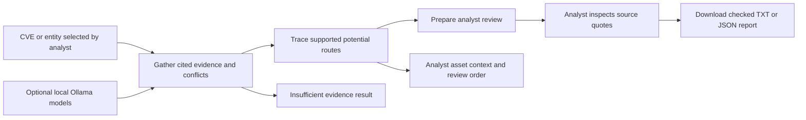

# AegisGraph — current architecture and flowcharts

AegisGraph turns documents, NVD/STIX/KEV catalogs and scanner reports into cited workspace evidence. Optional Ollama mode now runs real local extraction and semantic embeddings; the hash/rule demo remains available in a separate database. Neon and Neo4j await live connection checks. Remediation execution is not implemented. Investigation evidence can also be downloaded locally as revision-checked text and JSON reports. Analyst-supplied asset inventory now supports transparent route review ordering with missing-context flags. Repository review imports bounded public GitHub commit snapshots or ZIPs, applies five passive source rules and persists workspace review/comparison records. It does not establish exploit paths. Feature scope is frozen; hardening remains. Repository reviews now include cited Python/JS static import maps, route declaration candidates and per-file finding associations; these are not runtime attack paths.

Solid boxes: implemented. Dashed boxes: configured or planned; live verification may still be pending.

## System architecture

FastAPI enforces workspace roles. SQLite or Neon stores extraction batches, topics and request audit events. Queries traverse the embedded graph; Neo4j is an optional derived copy, not the active query engine. Ollama mode is loopback-only and rejects mixed embedding model profiles; it does not require cloud credentials. Repository review is a separate passive source-analysis branch with SQLite/Neon persistence; it does not inject unproven code edges into the graph.

```mermaid
flowchart LR
    docs["Documents, KEV and scanner reports"]
    api["FastAPI and workspace permissions"]
    pipeline["Rules or local Ollama extraction"]
    store["SQLite local or Neon storage"]
    graph["Embedded evidence graph"]
    vectors["Hash or learned local embeddings"]
    ui["React workspace and MCP tools"]
    investigate["LangGraph investigation"]
    neo4j["Optional Neo4j graph projection"]
    style neo4j stroke-dasharray: 5 5,fill:#263344
    cloud["Vercel and Render connections"]
    style cloud stroke-dasharray: 5 5,fill:#263344
    repository_source["Public GitHub commit or source ZIP"]
    source_review["Static source map, findings and comparison"]
    docs --> api
    api --> pipeline
    pipeline --> store
    store --> graph
    store --> vectors
    graph --> investigate
    investigate --> ui
    graph --> neo4j
    cloud --> api
    repository_source --> source_review
    source_review --> store
    source_review --> ui
```

## Scanner report and source flow

Trivy vulnerability JSON, OSV JSON and SARIF 2.1.0 are accepted through file upload. SARIF supports located CodeQL/Semgrep results. Selected fields become quoted observations; raw snippets and network requests are omitted. Secret-scanner SARIF is rejected. No scanner is executed by the import endpoint.

```mermaid
flowchart LR
    report["Trivy, OSV or SARIF report"]
    validate["Validate size, shape and fields"]
    normalize["Normalize selected fields"]
    snapshot["Deduplicated report snapshot"]
    quotes["Exact chunk offsets and quotes"]
    observations["Artifact, package and finding links"]
    inspect["Inspect evidence in the UI"]
    reason["Exploitability requires more evidence"]
    report --> validate
    validate --> normalize
    normalize --> snapshot
    snapshot --> quotes
    quotes --> observations
    observations --> inspect
    inspect --> reason
```



## LangGraph investigation workflow

LangGraph coordinates evidence retrieval, conflict review and potential-route tracing. Retrieval can now use real local Ollama embeddings and previously model-extracted facts. The workflow itself remains deterministic and read-only, with no generated commands or durable agent session. Analyst review supports fresh TXT/JSON downloads with quote-span and workspace-revision validation; generated reports are not stored as durable agent sessions. A separate asset-context view prioritizes supported routes using unverified analyst criticality/exposure; it does not alter source facts or certify exploitability.



## Document lifecycle and restart recovery

Sources and atomic operation checkpoints stay on disk. Completed batches, themes and audit metadata persist in SQLite/Neon. Restart reconstructs the graph and resumes nonterminal jobs whose source files remain available. Hosted disks/object storage still need configuration.

```mermaid
flowchart LR
    source["Unique retained source file"]
    accepted["Atomic accepted checkpoint"]
    batch["Build and commit extraction batch"]
    complete["Graph cache and completed receipt"]
    restart["Backend restart"]
    restore["Restore documents and themes"]
    resume["Resume unfinished operations"]
    reconcile["Reconcile optional Neo4j copy"]
    style reconcile stroke-dasharray: 5 5,fill:#263344
    source --> accepted
    accepted --> batch
    batch --> complete
    restart --> restore
    restore --> resume
    resume --> batch
    restore --> reconcile
```



## Repository security and runtime boundaries

GitHub workflows are configured for Semgrep rules, redacted Gitleaks history scans and CodeQL analysis. Gitleaks ran locally with no leaks; Semgrep local execution is blocked by its Windows socket error. CI results must be checked after push. Runtime controls enforce roles, upload limits, per-process rate limits and metadata-only audits.

```mermaid
flowchart LR
    commit["Pull request or main push"]
    semgrep["Semgrep code rules in Linux CI"]
    style semgrep stroke-dasharray: 5 5,fill:#263344
    gitleaks["Gitleaks redacted history scan"]
    codeql["CodeQL Python and JavaScript"]
    style codeql stroke-dasharray: 5 5,fill:#263344
    review["Review findings before release"]
    runtime["Roles, limits and request audit"]
    commit --> semgrep
    commit --> gitleaks
    commit --> codeql
    semgrep --> review
    gitleaks --> review
    codeql --> review
    review --> runtime
```



## Connection and integration boundaries

Local model inference and offline NVD/STIX/KEV/scanner imports work without cloud accounts. ZAP and Nuclei remain future integrations. Hosted services, real Neo4j-backed queries and distributed synchronization need later work.

```mermaid
flowchart LR
    local["Local reports and investigations"]
    neon["Connect Neon DB and Auth"]
    style neon stroke-dasharray: 5 5,fill:#263344
    hosts["Connect Vercel and Render"]
    style hosts stroke-dasharray: 5 5,fill:#263344
    neo["Verify Neo4j projection live"]
    style neo stroke-dasharray: 5 5,fill:#263344
    zap["ZAP localhost testing later"]
    style zap stroke-dasharray: 5 5,fill:#263344
    nuclei["Nuclei authorized checks later"]
    style nuclei stroke-dasharray: 5 5,fill:#263344
    models["Direct Neo4j traversal later"]
    style models stroke-dasharray: 5 5,fill:#263344
    local --> neon
    neon --> hosts
    hosts --> neo
    local --> zap
    zap --> nuclei
    neo --> models
```



## Upstream projects

- [LangGraph](https://github.com/langchain-ai/langgraph): Installed LangGraph workflow; optional real Ollama extraction and semantic embeddings supply its evidence. No model-driven remediation or durable agent sessions.
- [Trivy](https://github.com/aquasecurity/trivy): Offline vulnerability JSON adapter implemented. Scanner execution and misconfiguration imports are not integrated.
- [OSV-Scanner](https://github.com/google/osv-scanner): Offline dependency report adapter implemented. OSV scanning itself is external.
- [Semgrep](https://github.com/semgrep/semgrep): SARIF report import, local rules and pinned CI setup implemented. Local Windows RPC failure prevents a passing scan claim.
- [CodeQL](https://github.com/github/codeql): SARIF report import and GitHub workflow configured; GitHub code-scanning availability and CI results remain to be verified.
- [Gitleaks](https://github.com/gitleaks/gitleaks): Checksummed CLI verified locally; full committed history scan passed. Pinned redacted CI scan configured. Secret reports are not ingested.
- [ZAP](https://github.com/zaproxy/zaproxy): Future localhost web-security testing; not installed or run in this integration.
- [Nuclei](https://github.com/projectdiscovery/nuclei): Future authorized asset checks; no scan execution or report adapter implemented.
- [Ollama](https://github.com/ollama/ollama): Loopback-only adapter for installed local qwen2.5-coder and nomic-embed-text models. Real extraction and semantic embeddings verified; no cloud fallback or model downloads.
